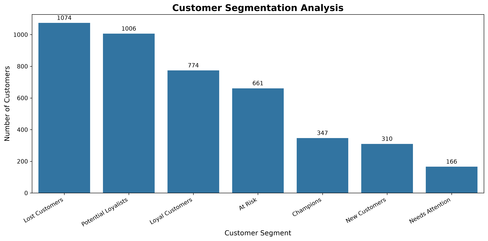
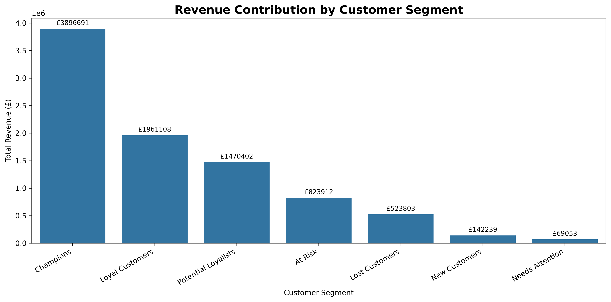
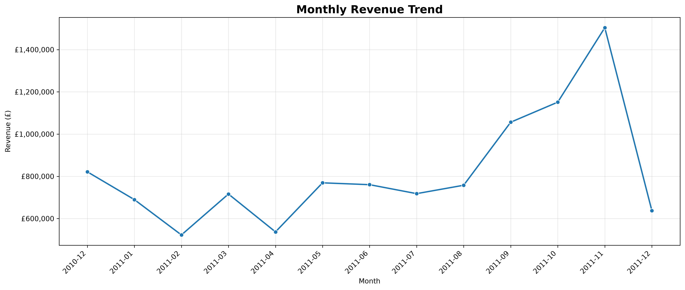
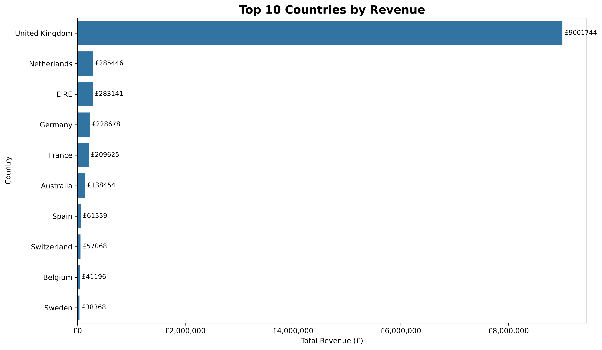
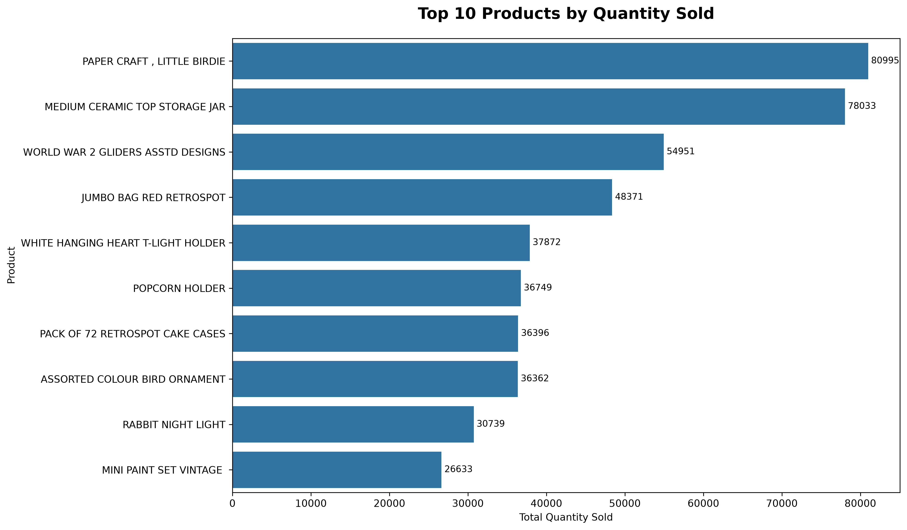
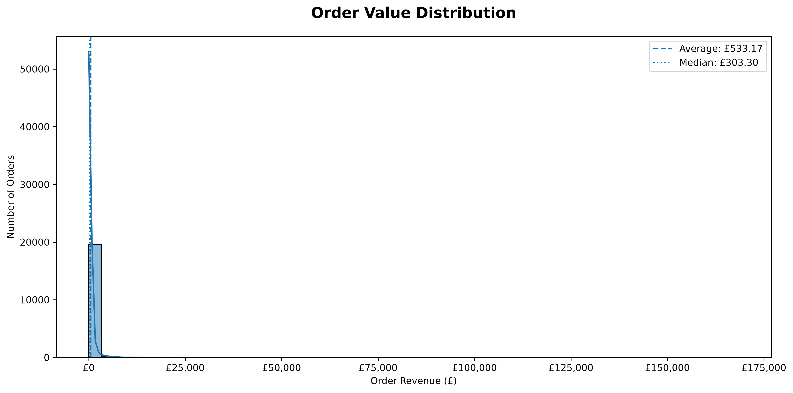
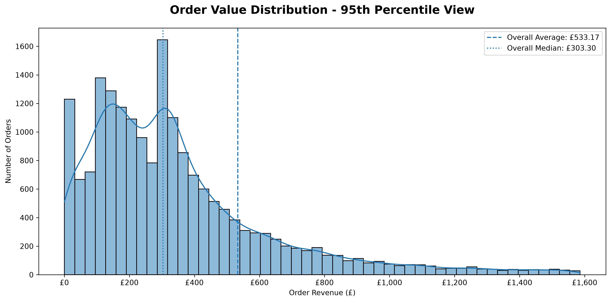
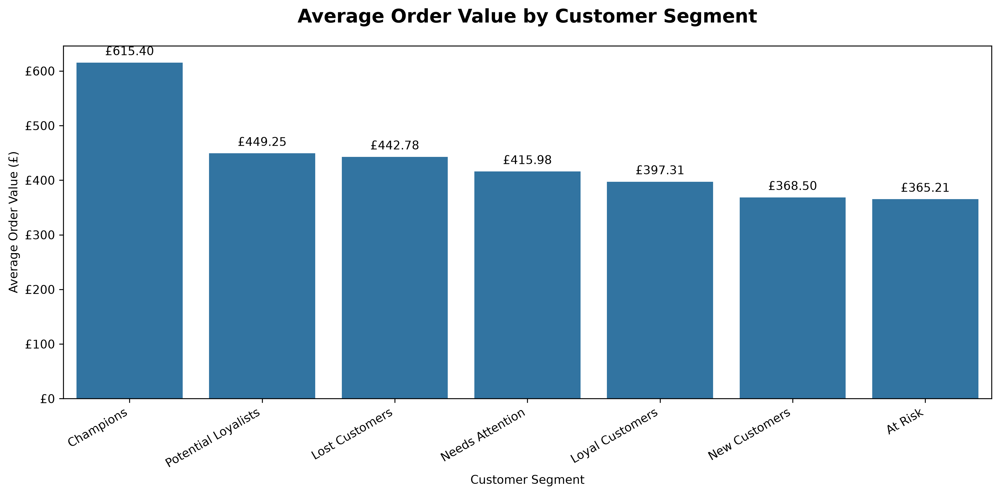

# Retail Sales & Customer Analytics Using Python

## Project Overview
This project analyzes historical online retail transactions to understand sales performance, product performance, customer purchasing behaviour, and customer value. Python is used for data cleaning, analysis, visualization, and RFM (Recency, Frequency, Monetary) customer segmentation.

## Business Objectives
- Analyze revenue, orders, and units sold.
- Identify monthly sales trends and top-performing products and countries.
- Understand one-time and repeat customer behaviour.
- Identify high-value customers using RFM analysis.
- Develop data-driven business recommendations.

## Tools & Technologies
- Python, Pandas, NumPy
- Matplotlib, Seaborn
- JupyterLab

## Dataset
**Source:** [UCI Machine Learning Repository – Online Retail Dataset](https://archive.ics.uci.edu/dataset/352/online+retail)

The dataset contains transactions from December 2010 to December 2011, including invoice numbers, product descriptions, quantities, invoice dates, unit prices, customer IDs, and countries.

## Project Workflow
1. Loaded and explored the raw dataset.
2. Checked missing values, duplicate records, and invalid transactions.
3. Cleaned sales data and calculated transaction revenue.
4. Analyzed overall sales and monthly revenue.
5. Identified top products and countries.
6. Analyzed customer purchase frequency and revenue.
7. Performed RFM customer segmentation.
8. Compared revenue and order value across customer segments.
9. Created visualizations and developed business recommendations.

## Key Business Results

| Metric | Result |
|---|---:|
| Total Revenue | £10,642,110.80 |
| Total Orders | 19,960 |
| Identified Customers | 4,338 |
| Units Sold | 5,572,420 |
| Average Order Value | £533.17 |
| Repeat Customers | 65.58% |
| UK Revenue Contribution | 84.59% |

## Key Insights
- November 2011 recorded the highest monthly revenue.
- The Regency Cake Stand 3 Tier was the highest-revenue merchandise product after excluding selected postage and manual entries.
- The United Kingdom contributed approximately 84.59% of total sales revenue.
- Approximately 65.58% of identified customers made more than one purchase during the observed period.
- Champions represented approximately 8% of identified customers and generated 43.85% of identified-customer revenue.
- Champions had the highest average order value among the customer segments.

## Visualizations

### Customer Segmentation


### Revenue by Customer Segment


### Monthly Revenue Trend


### Revenue by Country


### Top Products by Quantity


### Order Value Distribution


### Order Value Distribution — Zoomed


### Average Order Value by Segment


## Customer Segmentation
RFM analysis segments customers based on:
- **Recency:** How recently a customer purchased.
- **Frequency:** How often a customer purchased.
- **Monetary:** How much a customer spent.

Segments: Champions, Loyal Customers, Potential Loyalists, New Customers, At Risk, Lost Customers, and Needs Attention.

## Business Recommendations
- Introduce loyalty rewards and personalized offers for high-value customers.
- Run targeted campaigns to encourage inactive customers to purchase again.
- Explore opportunities to grow sales in markets outside the United Kingdom.
- Promote popular merchandise products.
- Use historical monthly sales patterns to support inventory planning.

## Project Structure
```text
Retail-Sales-Customer-Analytics-Python/
├── notebooks/
│   └── retail_sales_analysis.ipynb
├── outputs/
│   ├── average_order_value_by_segment.png
│   ├── customer_segmentation.png
│   ├── monthly_revenue_trend.png
│   ├── order_value_distribution.png
│   ├── order_value_distribution_zoomed.png
│   ├── segment_revenue_analysis.png
│   ├── top_10_countries_revenue.png
│   └── top_10_products_quantity.png
├── README.md
└── requirements.txt
```

## Important Notes
- The analysis uses historical 2010–2011 data and does not represent current retail performance.
- Customer-level analysis excludes transactions without a CustomerID.
- Overall sales metrics include valid sales transactions with and without a CustomerID.
- Repeat-customer percentage measures repeat purchases within the observed dataset period; it is not a formal cohort-retention calculation.
- December 2011 contains only partial-month data.
- RFM segment definitions are starter business rules created for this project.
- The original dataset and locally generated CSV files are not included in this repository. Download the source dataset from UCI.

## Author
**Chandan Prasad**

GitHub: [Chandanprasad7](https://github.com/Chandanprasad7)
